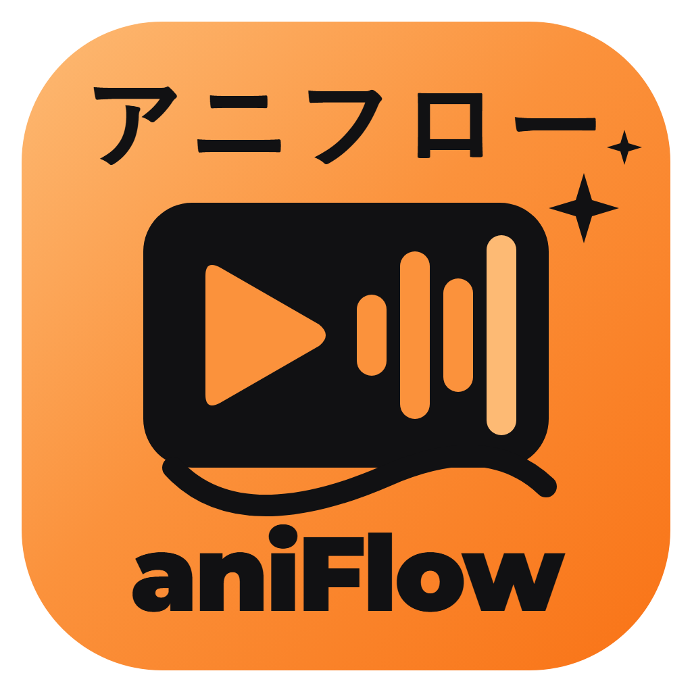

  

<h1 align="center">aniFlow (アニフロー)</h1>

  Gerador automatico de AMVs de anime. Escolhe as cenas, corta no sync da musica e renderiza na GPU.

  <a href="https://github.com/osvaldocordeiroandre/aniflow/releases/latest"><b>Baixar a versao mais recente</b></a>

## O que ele faz

Voce coloca o episodio (.mkv, .mp4, .mov) e a musica. O aniFlow monta o AMV na
timeline: cortes na batida, as melhores cenas, movimento de camera, transicoes,
efeitos e tipografia. Da para ajustar tudo e renderizar em 1920x1080 ou 1080x1920.

| modo | o que faz |
|---|---|
| **Edit Raw** | corte e sync, com movimento sempre presente, flash nos drops e shake nos golpes |
| **Aesthetic + Typo** | cortes mais longos, cenas calmas, grade de cor, glow, flares e a letra animada |
| **Shorts / TikTok** | 9:16, acha o trecho mais forte da musica, tilt 3D, light leaks e upscale com IA |

- Tira sozinho abertura, encerramento, vinheta do estudio e cenas com muito texto.
- Evita cenas longas de fala e cortes escondidos do anime.
- IA opcional, toda local (nenhuma API paga): reconhecer personagens, parallax 3D,
  camera lenta suave, letra pelo Whisper.

## Instalar

1. Baixe o `aniFlow-x.y.z-win-x64.exe` na [release mais recente](https://github.com/osvaldocordeiroandre/aniflow/releases/latest).
2. Rode o instalador.

Windows 10/11 64-bit. Com placa NVIDIA o preparo e o render ficam bem mais rapidos.

## Atualizacoes

O app procura versao nova sozinho e avisa quando tiver uma. Nao precisa baixar de novo.

---

Este repositorio guarda so as versoes do aplicativo; o codigo-fonte nao e publico.
